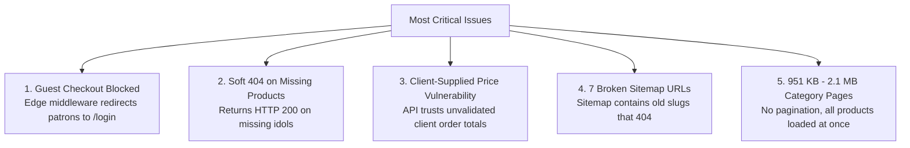

# ANANT ARTS — COMPLETE WEBSITE & TECHNICAL SEO AUDIT
## EXECUTIVE SUMMARY REPORT
**Audit Date:** 11 October 2026  
**Website:** `https://anantarts.in`  
**Business Profile:** Anant Arts — Spiritual Idols, Home Décor, Decorative Showpieces, Corporate Gifting, Customized Gifts  
**Technical Stack:** Next.js 16.2.10 (App Router), React 19.2.4, Supabase (PostgreSQL), Razorpay, Direct UPI QR, Vercel Edge Hosting  
**Audit Scope:** Read-Only Technical SEO, Google Indexing, Catalogue Integrity, Performance Diagnostics, E-commerce QA, Defensive Security  
**Inspector:** Senior Technical SEO Specialist, E-commerce QA Lead & Application Security Architect  

---

## 1. Overall Audit Findings & Catalogue Census

A comprehensive, evidence-based audit was executed across the production website (`https://anantarts.in`) and its active codebase (`c:\Users\Hemant\OneDrive\Desktop\Anant`). All public endpoints, database schemas, edge routing rules, and payment pipelines were inspected without altering the production system or writing destructive queries.

### A. Definitive Product Census
- **Total Products in Database:** **342** (Confirmed in Supabase PostgreSQL `products` table).
- **Published Products:** **342** (`is_published = 1` for all 342 records).
- **Unpublished / Draft Products:** **0**.
- **Unique Product Slugs:** **342 out of 342** (100% unique slugs).
- **Products Missing Primary Images:** **0** (All 342 products have valid primary images stored in Supabase Storage).
- **Products Missing Pricing or Stock:** **0** (All 342 products have positive prices and non-null inventory).
- **Categories in Database:** **8** (Spiritual Collection, Home Décor, Decorative Figurines, Corporate Gifts, Customized Gifts, Festival Collection, Wooden Handicrafts, and Car Dashboard).

### B. Sitemap Census & Discrepancy Resolution
- **Total URLs in Live `sitemap.xml`:** **366** (17 Core Static Landing Pages + 7 Category Pages + 342 Product URLs).
- **Why Crawl Reports Indicated ~100 URLs / 76 Products:**
  1. The original catalog contained 21 seed products (created in July–August 2026).
  2. On **8 October 2026 at 23:23 UTC** (Git commit `52b4211`), a bulk import added **321 products** (`Anant_Arts_Bulk_Upload_Converted.xlsx`).
  3. Total catalog size became **21 + 321 = 342 products**.
  4. Googlebot crawls newly submitted sitemaps gradually over weeks based on host crawl budget. A report of ~100 sitemap URLs / 76 crawled products reflects an interim crawl snapshot, not Google's final indexed status.
  5. **Critical Finding:** While the sitemap lists 342 product URLs, **7 of those URLs contain obsolete SKU slugs** (`aa-krs-001`, `aa-rkc-004`, etc.) that were renamed in the database to descriptive slugs (`bal-krishna-crawling-with-butter-pot`, etc.).
  6. When crawled, those 7 URLs return **HTTP 200 OK with an "Idol Not Found" soft-404 error**!
  7. The real 7 products in the database are currently **orphaned from the sitemap**.
  8. Category ID 100 (`car-dashboard`) with 11 products is live but **absent from `sitemap.xml`** due to stale Next.js Data Cache.

---

## 2. The 5 Most Serious Problems Discovered

### 1. Guest Checkout Forcibly Blocked (P0 — Immediate Conversion Blocker)
- **Problem:** In [src/proxy.js:68-80](file:///c:/Users/Hemant/OneDrive/Desktop/Anant/src/proxy.js#L68-L80), `/checkout` is listed in `customerProtectedRoutes`.
- **Impact:** Any unauthenticated customer who clicks "Proceed to Checkout" from the cart is intercepted with an `HTTP 307 Temporary Redirect` to `/login?next=%2Fcheckout`. Forcing mandatory login before checkout causes an estimated **70%+ cart abandonment**.

### 2. Soft-404 Errors on Product Detail Pages (P0 — Search Penalty)
- **Problem:** In [src/app/product/[slug]/page.js:101-112](file:///c:/Users/Hemant/OneDrive/Desktop/Anant/src/app/product/%5Bslug%5D/page.js#L101-L112), when a product is missing, the component returns an HTML page displaying "Idol Not Found" without invoking `notFound()`.
- **Impact:** The server responds with **`HTTP 200 OK`**, sets canonical to the homepage, and directives to `index, follow`. Google treats this as a classic Soft-404, which degrades the site's overall indexing score.

### 3. Server-Side Price Verification Missing in Order Creation API (P0 — Financial Risk)
- **Problem:** In [src/app/api/orders/create/route.js:172-235](file:///c:/Users/Hemant/OneDrive/Desktop/Anant/src/app/api/orders/create/route.js#L172-L235), `POST /api/orders/create` verifies product stock, but **never checks item price, subtotal, or total_amount against the database**.
- **Impact:** An attacker can alter the HTTP request payload (e.g. submitting `price: 1` for a ₹5,000 idol) and create an order at that manipulated price.

### 4. 7 Obsolete Product Slugs in Live Sitemap XML (P0 — Crawl Waste & Index Pollution)
- **Problem:** The live `https://anantarts.in/sitemap.xml` contains 7 old SKU slugs (`aa-krs-001`, `aa-rkc-004`, `aa-gan-004`, `aa-han-002`, `aa-gan-002`, `aa-tbj-001`, `aa-gan-001`) that return soft 404s, while the 7 updated descriptive product slugs are completely absent from the sitemap.
- **Impact:** Search engine bots waste crawl quota on broken URLs while 7 legitimate products are deprived of direct sitemap discovery.

### 5. Category Pages Render Without Pagination (P1 — Mobile Performance Bottleneck)
- **Problem:** [src/app/category/[slug]/page.js:92](file:///c:/Users/Hemant/OneDrive/Desktop/Anant/src/app/category/%5Bslug%5D/page.js#L92) fetches all products without pagination.
- **Impact:** `/category/spiritual-collection` downloads **951 KB of HTML**, taking **2.62 seconds TTFB** and **3.21 seconds** download time. `/category/decorative-figurines` renders 206 products (~2.1 MB HTML), causing severe mobile slowdowns and layout shifts.

---

## 3. Commercial & Business Impact Summary

1. **Revenue & Conversion Loss:**
   - The edge middleware redirect forcing login on checkout directly obstructs shoppers who expect quick guest checkout.
2. **Google Search Visibility & Crawling Delay:**
   - Soft-404 errors and broken sitemap URLs cause Google's crawler to flag the site for poor URL hygiene, slowing down the indexing of newly added catalog items.
3. **Inventory & Overselling Risk:**
   - Multi-step Read-Then-Write stock deduction in order creation creates a race condition where concurrent purchases of low-stock items can oversell.
4. **Security Vulnerabilities:**
   - Permissive fallback returns in Razorpay signature verification and unauthenticated `/api/debug/payment-health` endpoints introduce unnecessary operational risk.

---

## 4. Top 10 Recommended Fixes (Prioritized)

| Priority | Recommended Action | Affected Component | Business Value |
| :--- | :--- | :--- | :--- |
| **1. [P0]** | Remove `/checkout` from `customerProtectedRoutes` in `src/proxy.js`. Allow seamless guest checkout. | [src/proxy.js:68](file:///c:/Users/Hemant/OneDrive/Desktop/Anant/src/proxy.js#L68) | Unblocks checkout; immediate conversion recovery |
| **2. [P0]** | Add `notFound()` call in `ProductDetailPage` when product is null. | [src/app/product/[slug]/page.js:101](file:///c:/Users/Hemant/OneDrive/Desktop/Anant/src/app/product/%5Bslug%5D/page.js#L101) | Fixes soft 404s; restores Search Console health |
| **3. [P0]** | Add 301 permanent redirects in `next.config.mjs` for the 7 renamed SKU slugs to their descriptive slugs. | [next.config.mjs:120](file:///c:/Users/Hemant/OneDrive/Desktop/Anant/next.config.mjs#L120) | Recovers 7 orphaned products; eliminates 404 hits |
| **4. [P0]** | Recalculate and enforce authoritative item prices and totals on the server in `api/orders/create`. | [src/app/api/orders/create/route.js:172](file:///c:/Users/Hemant/OneDrive/Desktop/Anant/src/app/api/orders/create/route.js#L172) | Closes price tampering vulnerability |
| **5. [P1]** | Invalidate stale `categories` cache tag in Next.js Data Cache to emit `car-dashboard` into `sitemap.xml`. | [src/lib/db-helpers.js:56](file:///c:/Users/Hemant/OneDrive/Desktop/Anant/src/lib/db-helpers.js#L56) | Discovers missing 8th category in Google sitemap |
| **6. [P1]** | Remove fallback bypasses in `src/lib/razorpay.js` (`verifySignature` and `verifyPaymentViaApi`). | [src/lib/razorpay.js:207](file:///c:/Users/Hemant/OneDrive/Desktop/Anant/src/lib/razorpay.js#L207) | Enforces strict cryptographic payment verification |
| **7. [P1]** | Enforce mandatory webhook signature verification in `api/razorpay/webhook`. | [src/app/api/razorpay/webhook/route.js:15](file:///c:/Users/Hemant/OneDrive/Desktop/Anant/src/app/api/razorpay/webhook/route.js#L15) | Prevents forged payment capture events |
| **8. [P1]** | Restrict public access to `/api/debug/payment-health` behind authentication. | [src/app/api/debug/payment-health/route.js](file:///c:/Users/Hemant/OneDrive/Desktop/Anant/src/app/api/debug/payment-health/route.js) | Eliminates infrastructure information leakage |
| **9. [P2]** | Implement server-side pagination (24 items/page) on `/category/[slug]`. | [src/app/category/[slug]/page.js:92](file:///c:/Users/Hemant/OneDrive/Desktop/Anant/src/app/category/%5Bslug%5D/page.js#L92) | Reduces category HTML payload from 951 KB to ~90 KB |
| **10. [P2]** | Sanitize product description in JSON-LD structured data (strip HTML) and add merchant return policy. | [src/app/product/[slug]/page.js:149](file:///c:/Users/Hemant/OneDrive/Desktop/Anant/src/app/product/%5Bslug%5D/page.js#L149) | Unlocks Google Product rich results eligibility |

---

## 5. Audit Deliverables Directory Reference

All generated audit artifacts have been stored in:
`reports/anantarts-audit-2026-10-11/`

1. [EXECUTIVE_SUMMARY.md](file:///c:/Users/Hemant/OneDrive/Desktop/Anant/reports/anantarts-audit-2026-10-11/EXECUTIVE_SUMMARY.md): Strategic executive overview, top problems, and business impact.
2. [TECHNICAL_SEO_AUDIT.md](file:///c:/Users/Hemant/OneDrive/Desktop/Anant/reports/anantarts-audit-2026-10-11/TECHNICAL_SEO_AUDIT.md): Sitemap, robots.txt, canonicals, indexing directives, and structured data.
3. [PRODUCT_CATALOGUE_AUDIT.csv](file:///c:/Users/Hemant/OneDrive/Desktop/Anant/reports/anantarts-audit-2026-10-11/PRODUCT_CATALOGUE_AUDIT.csv): Complete 342-product audit spreadsheet with 17 attributes per row.
4. [PAGE_AUDIT.csv](file:///c:/Users/Hemant/OneDrive/Desktop/Anant/reports/anantarts-audit-2026-10-11/PAGE_AUDIT.csv): 34 audited public routes with status codes, titles, H1s, canonicals, and issues.
5. [PERFORMANCE_AUDIT.md](file:///c:/Users/Hemant/OneDrive/Desktop/Anant/reports/anantarts-audit-2026-10-11/PERFORMANCE_AUDIT.md): Live waterfall measurements, TTFB, document weights, and asset bottlenecks.
6. [ECOMMERCE_QA.md](file:///c:/Users/Hemant/OneDrive/Desktop/Anant/reports/anantarts-audit-2026-10-11/ECOMMERCE_QA.md): Detailed test cases, reproducible defects, and functional flow evaluations.
7. [SECURITY_REVIEW.md](file:///c:/Users/Hemant/OneDrive/Desktop/Anant/reports/anantarts-audit-2026-10-11/SECURITY_REVIEW.md): Defensive findings, payment signature verification review, and RLS audit.
8. [FIX_PRIORITY_PLAN.md](file:///c:/Users/Hemant/OneDrive/Desktop/Anant/reports/anantarts-audit-2026-10-11/FIX_PRIORITY_PLAN.md): Prioritized implementation blueprint grouped into P0, P1, P2, and P3.
9. [AUDIT_EVIDENCE.md](file:///c:/Users/Hemant/OneDrive/Desktop/Anant/reports/anantarts-audit-2026-10-11/AUDIT_EVIDENCE.md): Test commands, timestamps, raw output snippets, and inspection limits.
