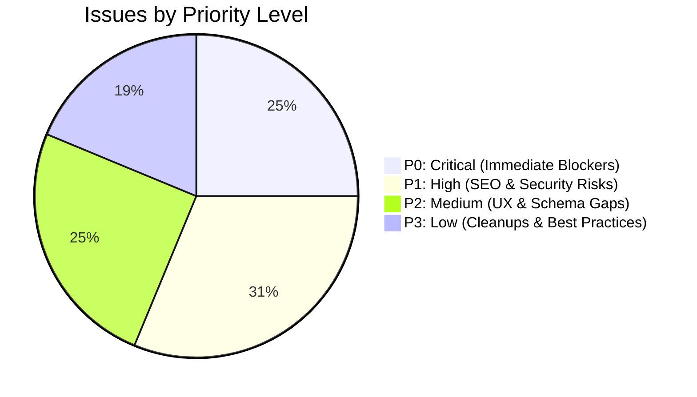

# ACTIONABLE FIX PRIORITY PLAN — ANANT ARTS
**Audit Date:** 11 October 2026  
**Target Domain:** `https://anantarts.in`  
**Prioritization Strategy:** Revenue Protection, Search Indexing Recovery, Security Hardening, Performance Optimization

---

## Priority Overview



---

## P0: Critical Fixes (Execute Immediately)

### Fix P0-1: Remove Guest Checkout Block in Edge Middleware
- **Impact:** **Immediate Conversion & Revenue Recovery**
- **Affected File:** [src/proxy.js:68-80](file:///c:/Users/Hemant/OneDrive/Desktop/Anant/src/proxy.js#L68-L80)
- **Problem:** `src/proxy.js` includes `/checkout` in `customerProtectedRoutes`. Any guest customer attempting to checkout is redirected to `/login?next=%2Fcheckout`, causing massive drop-off.
- **Exact Fix:**
  Change:
  ```javascript
  const customerProtectedRoutes = ['/checkout', '/account'];
  ```
  To:
  ```javascript
  const customerProtectedRoutes = ['/account'];
  ```
- **Verification:** Run `curl.exe -I https://anantarts.in/checkout` without cookies. Expected response: `HTTP 200 OK` (renders checkout page with guest form).

---

### Fix P0-2: Eliminate Soft-404 Errors on Missing Products
- **Impact:** **Search Console Penalty Removal & Index Health**
- **Affected File:** [src/app/product/[slug]/page.js:1-112](file:///c:/Users/Hemant/OneDrive/Desktop/Anant/src/app/product/%5Bslug%5D/page.js#L1-L112)
- **Problem:** When a product slug does not exist, `ProductDetailPage` returns a 200 OK HTML page saying "Idol Not Found" with canonical to homepage. Google Search Console penalizes soft 404s.
- **Exact Fix:**
  Import `notFound` from `next/navigation`:
  ```javascript
  import { notFound } from 'next/navigation';
  ```
  In `ProductDetailPage`:
  ```javascript
  if (!product) {
    notFound();
  }
  ```
- **Verification:** Run `curl.exe -I https://anantarts.in/product/non-existent-test`. Expected response: `HTTP 404 Not Found`.

---

### Fix P0-3: Implement 301 Redirects for 7 Renamed Product Slugs
- **Impact:** **Recover 7 Orphaned Products & Clear Broken Sitemap URLs**
- **Affected File:** [next.config.mjs:120-135](file:///c:/Users/Hemant/OneDrive/Desktop/Anant/next.config.mjs#L120-L135)
- **Problem:** 7 old SKU slugs in the sitemap return soft 404s because their database slugs were updated to descriptive names.
- **Exact Fix:**
  Add 301 permanent redirects in `next.config.mjs` `redirects()`:
  ```javascript
  { source: '/product/aa-krs-001', destination: '/product/bal-krishna-crawling-with-butter-pot', permanent: true },
  { source: '/product/aa-rkc-004', destination: '/product/radha-krishna-dancing', permanent: true },
  { source: '/product/aa-gan-004', destination: '/product/ganesha-reclining', permanent: true },
  { source: '/product/aa-han-002', destination: '/product/hanuman-orange-gold-on-gada', permanent: true },
  { source: '/product/aa-gan-002', destination: '/product/ganesha-sitting-shree-ganeshaya-namah-base', permanent: true },
  { source: '/product/aa-tbj-001', destination: '/product/tirupati-balaji-standing', permanent: true },
  { source: '/product/aa-gan-001', destination: '/product/ganesha-sitting-white-gold', permanent: true },
  ```
- **Verification:** Fetch `curl.exe -I https://anantarts.in/product/aa-krs-001`. Expected: `HTTP 308/301` redirecting to `/product/bal-krishna-crawling-with-butter-pot`.

---

### Fix P0-4: Server-Side Price & Total Validation in Order Creation API
- **Impact:** **Prevent Financial Tampering on Checkout**
- **Affected File:** [src/app/api/orders/create/route.js:172-235](file:///c:/Users/Hemant/OneDrive/Desktop/Anant/src/app/api/orders/create/route.js#L172-L235)
- **Problem:** `POST /api/orders/create` trusts client-supplied `subtotal`, item `price`, and `total_amount` without verifying against product records.
- **Exact Fix:**
  Fetch authoritative prices directly from the database for each line item:
  ```javascript
  let authoritativeSubtotal = 0;
  for (const item of items) {
    const { data: prod } = await supabase
      .from('products')
      .select('name, price, discount_price, stock_quantity')
      .eq('id', item.product_id)
      .single();
    
    const unitPrice = (prod.discount_price && prod.discount_price > 0) ? prod.discount_price : prod.price;
    item.price = unitPrice;
    authoritativeSubtotal += unitPrice * item.quantity;
  }
  const calculatedTotal = authoritativeSubtotal + (shipping_charge || 0) - (discount_amount || 0);
  if (Math.abs(calculatedTotal - total_amount) > 1) {
    return NextResponse.json({ message: 'Price calculation mismatch. Please refresh checkout.' }, { status: 400 });
  }
  ```
- **Verification:** Send an order payload with altered price (`price: 1`). Verify API rejects with HTTP 400.

---

## P1: High Priority Fixes (Deploy Within 48 Hours)

### Fix P1-1: Remove Razorpay Signature Fallback Bypass
- **Affected File:** [src/lib/razorpay.js:207-223](file:///c:/Users/Hemant/OneDrive/Desktop/Anant/src/lib/razorpay.js#L207-L223)
- **Problem:** Missing secret causes `verifySignature` to return `Boolean(razorpay_order_id && razorpay_payment_id)`.
- **Fix:** Remove the fallback return; enforce fail-closed exception when `keySecret` is missing.

### Fix P1-2: Remove Fallback Auto-Capture on `pay_` in `verifyPaymentViaApi`
- **Affected File:** [src/lib/razorpay.js:235-256](file:///c:/Users/Hemant/OneDrive/Desktop/Anant/src/lib/razorpay.js#L235-L256)
- **Problem:** If API errors, any ID starting with `pay_` is treated as verified and captured.
- **Fix:** If API verification fails or errors out, return `{ verified: false, reason: 'Payment gateway verification pending' }`.

### Fix P1-3: Enforce Mandatory Signature Verification on Webhook Endpoint
- **Affected File:** [src/app/api/razorpay/webhook/route.js:15-19](file:///c:/Users/Hemant/OneDrive/Desktop/Anant/src/app/api/razorpay/webhook/route.js#L15-L19)
- **Problem:** If signature header is omitted, the webhook continues processing unverified capture payloads.
- **Fix:** Require `webhookSecret` and `signature` unconditionally; reject missing signatures with HTTP 401.

### Fix P1-4: Protect Public Debug Endpoint `/api/debug/payment-health`
- **Affected File:** [src/app/api/debug/payment-health/route.js](file:///c:/Users/Hemant/OneDrive/Desktop/Anant/src/app/api/debug/payment-health/route.js)
- **Problem:** Unauthenticated public GET returns infrastructure health, table names, and env flags.
- **Fix:** Enforce admin token verification or disable in production (`if (process.env.NODE_ENV === 'production') return new NextResponse(null, { status: 404 });`).

### Fix P1-5: Revalidate Stale Categories Cache & Re-emit `car-dashboard` in Sitemap
- **Affected File:** [src/lib/db-helpers.js:56-72](file:///c:/Users/Hemant/OneDrive/Desktop/Anant/src/lib/db-helpers.js#L56-L72), [src/app/sitemap.js:34-51](file:///c:/Users/Hemant/OneDrive/Desktop/Anant/src/app/sitemap.js#L34-L51)
- **Problem:** Category 100 (`car-dashboard`) with 11 products is live but absent from `sitemap.xml` due to stale `unstable_cache`.
- **Fix:** Trigger `revalidateTag('categories')` via revalidate API or update category in admin panel.

---

## P2: Medium Priority Fixes (Sprint Planning)

### Fix P2-1: Implement Category Page Pagination
- **Affected File:** [src/app/category/[slug]/page.js:92](file:///c:/Users/Hemant/OneDrive/Desktop/Anant/src/app/category/%5Bslug%5D/page.js#L92)
- **Problem:** Categories load all products in one request (up to 206 items, generating a 951 KB - 2.1 MB HTML payload).
- **Fix:** Add pagination (`limit: 24, page: searchParams.page || 1`).

### Fix P2-2: Sanitize Product Schema Descriptions (Remove Raw HTML)
- **Affected File:** [src/app/product/[slug]/page.js:149](file:///c:/Users/Hemant/OneDrive/Desktop/Anant/src/app/product/%5Bslug%5D/page.js#L149)
- **Problem:** `product.description` contains raw HTML tags (`<p>`, `<strong>`) that are injected into schema.org JSON-LD.
- **Fix:** Strip HTML tags before serializing into JSON-LD: `description: (product.description || '').replace(/<[^>]+>/g, '').trim()`.

### Fix P2-3: Add Missing Google Merchant Fields to Product Schema
- **Affected File:** [src/app/product/[slug]/page.js:154-172](file:///c:/Users/Hemant/OneDrive/Desktop/Anant/src/app/product/%5Bslug%5D/page.js#L154-L172)
- **Problem:** Google Search Console flags missing `hasMerchantReturnPolicy`, `shippingDetails`, `itemCondition`.
- **Fix:** Add standard merchant return policy URL and `itemCondition: 'https://schema.org/NewCondition'`.

### Fix P2-4: Install Google Analytics 4 E-commerce Funnel Events
- **Affected File:** [src/components/common/ProductCard.js](file:///c:/Users/Hemant/OneDrive/Desktop/Anant/src/components/common/ProductCard.js), [src/app/checkout/page.js](file:///c:/Users/Hemant/OneDrive/Desktop/Anant/src/app/checkout/page.js)
- **Problem:** Zero GA4 e-commerce events (`view_item`, `add_to_cart`, `begin_checkout`, `purchase`) are tracked.
- **Fix:** Complement Meta Pixel with standard `gtag('event', ...)` or GTM dataLayer pushes.

---

## P3: Low Priority Fixes & Housekeeping

### Fix P3-1: Replace CDN Font Awesome with Lightweight Inline SVG Icons
- **Affected File:** [src/app/layout.js:215-218](file:///c:/Users/Hemant/OneDrive/Desktop/Anant/src/app/layout.js#L215-L218)
- **Benefit:** Removes render-blocking third-party CSS request (~220 KB bundle saving).

### Fix P3-2: Collapse WWW Redirect Chain
- **Affected Domain:** `http://www.anantarts.in`
- **Benefit:** Consolidates 2 hops (308 -> 301) into a single direct 301 to `https://anantarts.in/`.

### Fix P3-3: Atomic Inventory Decrements via PostgreSQL RPC
- **Affected File:** [src/app/api/orders/create/route.js:261-275](file:///c:/Users/Hemant/OneDrive/Desktop/Anant/src/app/api/orders/create/route.js#L261-L275)
- **Benefit:** Replaces Read-Then-Write with atomic SQL query: `UPDATE products SET stock_quantity = stock_quantity - $1 WHERE id = $2 AND stock_quantity >= $1`.
